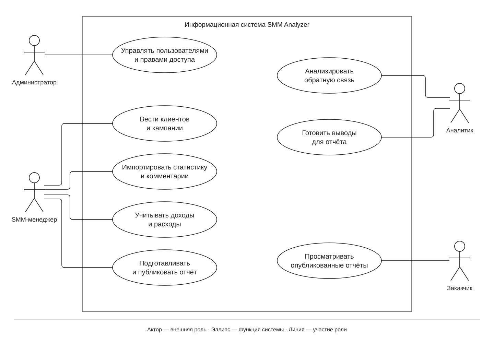
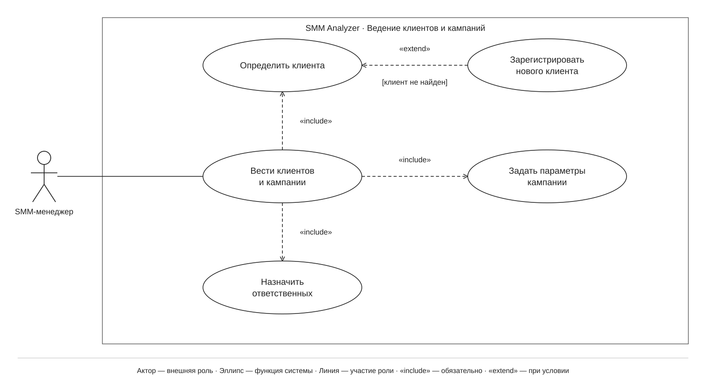
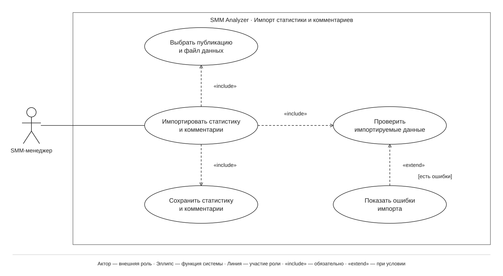
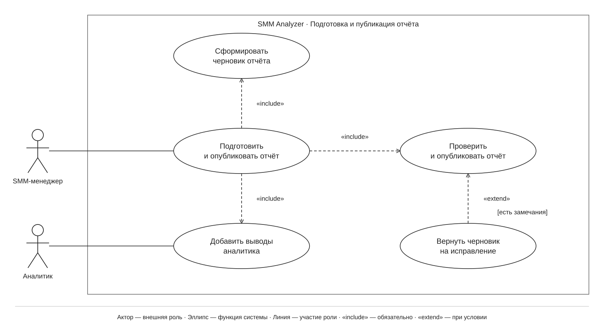

# Варианты использования SMM Analyzer: теория и разбор

Этот комплект относится только к разделу 2.1. В нём одна контекстная диаграмма и три детализации. Система предназначена для малого SMM-агентства: сотрудники ведут кампании клиентов, загружают статистику и комментарии, анализируют обратную связь и предоставляют заказчику отчёты. Приложение пока проектируется.

## Как читать диаграмму

Начинай с человечка: это роль, которая взаимодействует с системой. Затем смотри, к каким эллипсам он подключён. Каждый эллипс называет возможность системы. Линия участия сама по себе не задаёт порядок действий. Порядок поясняется сценарием под диаграммой.

| Обозначение | Значение | Пример в нашей системе |
|---|---|---|
| Человечек — актор | Внешняя по отношению к программной системе роль | SMM-менеджер работает с кампаниями |
| Эллипс — вариант использования | Функция системы, рассматриваемая во взаимодействии с актором | Импортировать статистику и комментарии |
| Прямоугольник — граница системы | Отделяет возможности приложения от действующих лиц | Внутри SMM Analyzer находятся функции, снаружи — сотрудники и заказчик |
| Сплошная линия | Участие роли в функции | Заказчик просматривает опубликованные отчёты |
| Штриховая стрелка «include» | Обязательная часть поведения базового варианта | Импорт включает проверку данных |
| Штриховая стрелка «extend» | Дополнительное поведение при заданном условии | Ошибки показываются, если проверка их обнаружила |

**Направление важно:** «include» идёт ОТ основного варианта К обязательной части. «extend» идёт ОТ условного дополнения К тому варианту, который оно дополняет. У стрелок открытые наконечники. У обычных линий участия наконечников нет.

Обобщение — ещё один вид связи UML: сплошная линия с пустым треугольником, направленным к более общей роли или функции. В этих четырёх диаграммах оно не требуется, поэтому треугольников нет.

## 1. Контекстная диаграмма

Контекст — вид всей системы снаружи. Здесь четыре роли и восемь крупных возможностей:

- Администратор управляет пользователями и правами доступа.
- SMM-менеджер ведёт клиентов и кампании, импортирует данные, учитывает доходы и расходы, подготавливает и публикует отчёты.
- Аналитик анализирует обратную связь и готовит выводы для отчёта.
- Заказчик просматривает опубликованные отчёты.

Актор означает роль, а не конкретного человека: сотрудник может совмещать обязанности менеджера и аналитика. Заказчик представлен как пользователь приложения; «клиент» в карточке кампании — организация, для которой ведётся работа.

Линии не означают передачу файлов или сетевые запросы. Например, связь заказчика с просмотром отчётов означает, что такой сценарий ему доступен. Отсутствие линии не заменяет подробную матрицу доступа: здесь показаны основные обязанности ролей.

Вход в систему — общее предусловие защищённых сценариев. Мы не проводим от каждого эллипса отдельную связь к аутентификации. Сервер должен проверять разрешения при каждом защищённом запросе, даже если экран уже открыт. Заказчик получает доступ только к отчётам своего клиента, сотрудники — в пределах назначенных кампаний. Администратор назначает эти права.

## 2. Ведение клиентов и кампаний

В центре — укрупнённая функция менеджера. В этой детализации раскрыт основной сценарий оформления кампании: определить клиента, задать параметры кампании и назначить ответственных. Все три части обязательны для этого сценария и соединены через «include».

**Предусловия:** менеджер вошёл в систему и имеет право вести кампании.

**Основной поток:**

1. Менеджер выбирает клиента, для которого оформляется кампания.
2. Указывает название, цель, период и плановый бюджет.
3. Назначает ответственных сотрудников.
4. Система проверяет допустимость значений и сохраняет связанную с клиентом кампанию.

**Альтернативный поток:** если нужного клиента ещё нет, при определении клиента выполняется «Зарегистрировать нового клиента». Поэтому стрелка «extend» направлена от регистрации к определению клиента. После регистрации работа продолжается с созданной карточкой клиента.

**Точка расширения:** определение клиента. **Условие:** нужный клиент отсутствует в справочнике.

**Постусловие успеха:** кампания сохранена, у неё определены клиент, параметры и ответственные. Если данные недопустимы, система сообщает о проблеме и не сохраняет некорректную запись.

Не нужно читать три обязательные связи как требование заново назначать сотрудников при каждом просмотре карточки. Здесь раскрыт сценарий оформления кампании; просмотр, архивирование и прочие операции в эту выбранную детализацию не включены.

## 3. Импорт статистики и комментариев

Менеджер связывает файл с конкретной публикацией. Система проверяет данные и сохраняет статистику и комментарии. Показ ошибок — условное дополнение к проверке данных.

**Предусловия:** менеджер аутентифицирован, имеет доступ к кампании; публикация зарегистрирована, файл подготовлен в поддерживаемом формате.

**Основной поток:**

1. Менеджер выбирает публикацию и файл со статистикой и комментариями.
2. Система проверяет полномочия, формат, обязательные поля и допустимость значений.
3. Система сохраняет прошедшие проверку данные с привязкой к публикации.
4. Менеджер получает результат импорта.

**Альтернативный поток:** при ошибках выполняется «Показать ошибки импорта». Сохранение недопустимых данных не выполняется. Менеджер может исправить файл и повторить импорт.

**Точка расширения:** результат проверки импортируемых данных. **Условие:** проверка обнаружила ошибки.

**Постусловие успеха:** статистика и комментарии доступны для анализа. Повторная загрузка тех же данных не должна создавать дубликаты. Ошибочный импорт не должен оставлять частично записанный набор: сохранение согласованного набора выполняется атомарно.

«include» означает обязательную часть успешного поведения; оно не обещает сохранение при проваленной проверке. Ошибочная ветвь прерывает основной поток.

Импорт в данном проекте — загрузка подготовленного файла. Прямая интеграция с API социальной сети на диаграмме не заявлена. Форматы файлов и внутренний механизм фоновой обработки уточняются в моделях проектирования.

## 4. Подготовка и публикация отчёта

Менеджер отвечает за подготовку и публикацию отчёта. Аналитик участвует в обязательной части «Добавить выводы аналитика». Эти роли могут выполнять разные сотрудники или один сотрудник с соответствующими правами.

**Предусловия:** участники вошли в систему, имеют права на кампанию; для выбранного периода доступны исходные данные.

**Основной поток:**

1. Менеджер выбирает кампанию и период. Система формирует черновик по доступным показателям и финансовым данным.
2. Аналитик добавляет выводы об обратной связи и эффективности видеоконтента.
3. Менеджер отправляет подготовленный отчёт на публикацию.
4. Система проверяет права, заполненность отчёта и актуальность его исходных данных.
5. При успешной проверке создаётся опубликованная версия, доступная соответствующему заказчику.

**Альтернативный поток:** при замечаниях выполняется «Вернуть черновик на исправление». Отчёт остаётся черновиком. После исправления менеджер может повторить публикацию.

**Точка расширения:** результат проверки перед публикацией. **Условие:** отчёт неполон либо исходные данные изменились.

**Постусловие успеха:** опубликована зафиксированная версия отчёта; её содержание не меняется от последующего редактирования черновика. Публикация регистрируется в журнале действий.

У аналитика нет прямой линии к публикации: в принятом распределении обязанностей он готовит выводы, а публикацию выполняет менеджер. Заказчик появляется на контекстной схеме в отдельном сценарии просмотра готового отчёта.

## Как объяснить работу на защите

«Я спроектировал систему для небольшого SMM-агентства. Сначала определил четыре роли и их основные задачи на контекстной диаграмме. Затем раскрыл три функции: ведение кампаний, импорт и отчётность. Обязательные части связал отношением include, условные дополнения — extend. Сценарии описывают обязанности пользователя и системы, предусловия, успешный результат и обработку исключений».

Частые вопросы:

- **Почему нет Next.js, PostgreSQL и классов?** Этот раздел описывает функциональные требования. Технологии и внутреннее устройство относятся к последующим моделям.
- **Это блок-схема?** Здесь связи показывают участие и состав поведения. Для порядка действий и ветвлений будут диаграммы деятельности.
- **Почему include и extend смотрят в разные стороны?** Include указывает на обязательную используемую часть. Extend указывает на базовый вариант, к которому добавляется условное поведение.
- **Почему нет ML?** В курсовой предусмотрена функция анализа. Обучение модели относится к будущей ВКР; метод анализа не определяется этой диаграммой.
- **Где защита информации?** Вход — предусловие; права ограничивают доступ к кампаниям и отчётам; проверки, отсутствие дубликатов, атомарное сохранение и фиксированные версии поддерживают целостность.

## Основания и принятые решения

[Анисимов В. В. Диаграммы вариантов использования, тема 12](https://sites.google.com/site/anisimovkhv/learning/pris/lecture/tema12/tema12_2): контекст и детализации, обозначения, направления связей, описание потоков событий. Страница содержит встроенный HTML; его текст изучен непосредственно.

Работа Я. С. Смолина «Курсовая работа проектирование.docx», предоставленная пользователем: ориентир по составу раздела и расположению элементов. Предметная область и сценарии в текущем комплекте относятся к SMM Analyzer.

Скилл diagram-design использован для ручной компоновки, разделения маршрутов, отступов подписей и самодостаточного HTML. Отдельного типа Use Case в скилле нет. Учебная UML-нотация имеет приоритет над его декоративными шаблонами: белый фон, обычный шрифт, эллипсы и акторы, стандартное написание «include» и «extend». Цветовые акценты и декоративные карточки не применены по ранее заданному ориентиру на пример курсовой.

HTML — основной визуальный исходник. SVG — векторная иллюстрация для отчёта. Draw.io — версия для ручного редактирования; связи имеют фиксированные маршруты, после перемещения фигур их точки нужно подправить. Эта особенность нужна, чтобы редактор не перестраивал линии самопроизвольно.
