# Теория по UML и защите курсовой работы SMM Analyzer

## 1. Что проектируется

SMM Analyzer — проект информационной системы для малого SMM-агентства. Система должна хранить клиентов, кампании и публикации, импортировать статистику и комментарии, анализировать обратную связь, учитывать доходы и расходы и формировать отчёты.

Работа является проектом, а не описанием уже написанной программы. Диаграммы отвечают на разные вопросы о будущей системе:

1. **Модель вариантов использования:** кто и зачем обращается к системе.
2. **Модель анализа:** какие обязанности и предметные сущности нужны для выполнения сценариев.
3. **Модель проектирования:** из каких программных классов и процессов будет состоять решение.
4. **Модель реализации:** как код будет разделён на компоненты и где они будут исполняться.

Главное правило согласованности: один и тот же смысл должен прослеживаться на всех уровнях. Если в вариантах использования есть импорт статистики, то далее должны появиться сущность задания импорта, последовательность его обработки, сервис импорта, программный компонент и место его выполнения.

## 2. Базовые понятия UML

UML — язык графического моделирования. Диаграмма не является картинкой интерфейса и не обязана показывать каждую техническую мелочь. Она выделяет один аспект системы с нужной степенью подробности.

Перед созданием любой диаграммы нужно определить:

- какую систему или процесс моделируют;
- кто будет читать схему;
- на какой вопрос она отвечает;
- какие подробности можно исключить;
- где проходит граница рассматриваемой системы.

Если в одной схеме одновременно показывать пользовательские цели, таблицы базы данных, сетевые узлы и внутренние методы, получится «спагетти». Поэтому разные уровни вынесены в разные диаграммы.

## 3. Диаграммы вариантов использования

### Назначение

Диаграмма вариантов использования показывает функциональные цели внешних участников. Она отвечает на вопросы: **кто работает с системой и какой результат хочет получить**.

### Элементы

- **Актор** — внешняя роль, человек или другая система. Актор — это роль, а не конкретная фамилия.
- **Вариант использования** — цель актора, записанная глаголом: «Импортировать данные», «Опубликовать отчёт».
- **Граница системы** — прямоугольник с названием системы. Варианты использования находятся внутри, акторы — снаружи.
- **Ассоциация** — сплошная линия между актором и доступной ему функцией.
- **`include`** — обязательное включение другого поведения. Базовый сценарий не выполняется без включаемого шага.
- **`extend`** — дополнительное поведение, возникающее при условии. Базовый сценарий остаётся законченным без расширения.
- **Обобщение** — наследование роли или общего поведения.

### Как не ошибиться

Вариант использования должен выражать ценность для актора. «Нажать кнопку» слишком мелко, а «Работать с системой» слишком широко. Проверка пароля обычно является частью сценария, а не самостоятельной бизнес-целью.

Нельзя путать `include` и `extend`:

- «Опубликовать отчёт» **включает** проверку версии, потому что проверка обязательна.
- «Добавить рекомендации» может **расширять** подготовку черновика, если это дополнительный этап.

### В SMM Analyzer

- Владелец агентства управляет пользователями и доступом.
- SMM-менеджер ведёт кампании, импортирует данные и публикует отчёты.
- Аналитик изучает обратную связь и формирует выводы.
- Заказчик читает только опубликованные отчёты своей организации.

Контекстная диаграмма показывает общий охват. Отдельные диаграммы импорта, анализа и отчётности раскрывают состав сложных сценариев.

## 4. Диаграммы автоматов

### Назначение

Диаграмма автомата, или состояний, описывает жизненный цикл **одного объекта**. Она отвечает на вопрос: **в каком состоянии может находиться объект и какое событие переводит его в другое состояние**.

### Элементы

- чёрная точка — начальное псевдосостояние;
- прямоугольник с закруглениями — состояние;
- стрелка — переход;
- надпись у стрелки — событие, условие и действие;
- `[условие]` — сторожевое условие, при котором переход разрешён;
- мишень — конечное состояние.

Состояние должно быть устойчивым во времени. «Проверить файл» является действием, а `VALIDATING` — состоянием задания, пока проверка продолжается.

### В SMM Analyzer

Кампания проходит состояния `DRAFT`, `ACTIVE`, `PAUSED`, `COMPLETED`, `ARCHIVED`. Задание импорта проходит `QUEUED`, `VALIDATING`, `APPLYING`, после чего завершается как `SUCCEEDED` или `FAILED`. Отчёт создаётся как `DRAFT`, публикуется как `PUBLISHED`, а при выпуске исправленной версии старая версия становится `SUPERSEDED`.

При защите важно объяснить, что диаграмма состояний описывает объект, а диаграмма деятельности — весь процесс с участием нескольких исполнителей.

## 5. Модель анализа и классы анализа

### Назначение

Модель анализа является переходом от требований к архитектуре. Здесь ещё не нужно привязываться к NestJS или PostgreSQL. Определяются обязанности объектов и устойчивые понятия предметной области.

Часто применяют три вида классов:

- **Boundary (граничный класс)** — точка взаимодействия: страница кампании, форма импорта, страница аналитики.
- **Control (управляющий класс)** — координирует сценарий: управление импортом, анализом, отчётами.
- **Entity (сущность)** — хранит значимые предметные данные: клиент, кампания, публикация, отчёт.

Типичная цепочка выглядит так:

`Актор → Boundary → Control → Entity`.

Интерфейс не должен сам выполнять бизнес-правила, а сущность не должна знать детали веб-страницы.

### Связи и кратности

Кратность показывает допустимое количество связанных объектов:

- `1` — ровно один;
- `0..1` — объект может отсутствовать;
- `0..*` — любое количество, включая ноль;
- `1..*` — не менее одного.

Например, один клиент может иметь несколько кампаний, а кампания до начала работы может не иметь ни одной публикации. Поэтому связь читается как `Client 1 — 0..* Campaign`.

## 6. Диаграммы последовательности

### Назначение

Диаграмма последовательности показывает взаимодействие участников во времени. Она отвечает на вопрос: **кто кому и в каком порядке отправляет сообщения в рамках одного сценария**.

### Элементы

- участник сверху — актор или объект;
- пунктирная вертикальная линия — линия жизни;
- горизонтальная стрелка — сообщение;
- пунктирная обратная стрелка — возвращаемый результат;
- узкий прямоугольник — период активности объекта;
- `alt` — взаимоисключающие ветви;
- `opt` — необязательная ветвь;
- `loop` — повторение;
- `par` — параллельное выполнение.

Время идёт сверху вниз. Горизонтальное расстояние не означает длительность.

### Как составлять

1. Выбрать один вариант использования.
2. Поставить актора слева.
3. Добавить только тех участников, которые нужны для этого сценария.
4. Провести основной успешный поток.
5. Добавить одну-две важные альтернативы через `alt`.
6. Проверить, что каждое сообщение имеет понятного отправителя и получателя.

В отчёте технические проверки доступа объединены внутри сервисов. Это сделано для читаемости: наличие шага «проверить доступ» не означает, что вся проверка будет написана одним методом.

### В SMM Analyzer

- Импорт: менеджер отправляет файл, сервис создаёт задание, Worker обрабатывает его, база хранит результат.
- Анализ: аналитик запускает сценарий, сервис фиксирует снимок комментариев, AnalysisProvider возвращает оценки.
- Отчёт: менеджер публикует черновик, сервис проверяет его и формирует клиентскую версию, заказчик читает опубликованный результат.

## 7. Диаграммы коммуникации

### Назначение

Диаграмма коммуникации показывает то же взаимодействие, что и последовательность, но делает акцент на **связях между объектами**. Вертикальной оси времени нет, поэтому порядок задаётся номерами сообщений.

Например:

- `2` — страница передала запрос сервису;
- `2.1` — сервис выполнил внутреннюю проверку;
- `2.2` — сервис записал данные;
- `2.3` — база вернула результат.

Диаграмму удобно использовать для проверки связанности. Если каждый объект напрямую обращается к базе данных или один объект связан со всеми остальными, ответственность распределена плохо.

В проекте импорт разделён на регистрацию задания и фоновую обработку. Так каждая коммуникационная диаграмма остаётся короткой и показывает один этап.

## 8. Проектные диаграммы классов

### Назначение

Диаграмма классов показывает статическую структуру будущего программного решения: классы, поля, операции и отношения.

### Запись класса

Прямоугольник обычно состоит из трёх частей:

1. имя класса;
2. атрибуты;
3. операции.

Перед членом класса может стоять видимость:

- `+` — public;
- `-` — private;
- `#` — protected;
- `~` — package.

Запись `+publish(expectedVersion): Report` читается как публичная операция `publish`, принимающая ожидаемую версию и возвращающая объект `Report`.

### Основные отношения

- **Ассоциация** — объекты связаны и знают друг о друге.
- **Зависимость** — один элемент временно использует другой; пунктирная стрелка.
- **Обобщение** — наследование; стрелка с пустым треугольником к родителю.
- **Реализация** — класс реализует интерфейс; пунктир с пустым треугольником.
- **Агрегация** — слабое отношение «целое–часть», пустой ромб.
- **Композиция** — сильное владение, закрашенный ромб; часть не имеет самостоятельного жизненного цикла вне целого.

Композицию нельзя ставить только ради красивого ромба. Она нужна, если часть принадлежит одному владельцу и удаляется вместе с ним.

### Логическая и физическая модели

**Логическая модель** показывает предметные классы: User, Client, Campaign, Publication, Report. Она ближе к бизнес-смыслу.

**Физическая модель** показывает классы реализации: контроллеры NestJS, сервисы, интерфейсы репозиториев, адаптеры TypeORM и Worker.

Разделение на несколько диаграмм сделано сознательно. Одна огромная схема со всеми полями и зависимостями была бы формально полной, но плохо читаемой.

### ООП в проекте

- **Инкапсуляция:** изменение состояния происходит через операции сущности или сервис, а не произвольной записью поля.
- **Абстракция:** `AnalysisProvider` описывает общий договор анализа без привязки к алгоритму.
- **Полиморфизм:** RuleBasedAnalyzer в будущем можно заменить ML-провайдером с тем же интерфейсом.
- **Разделение ответственности:** контроллер принимает HTTP-запрос, сервис выполняет сценарий, репозиторий сохраняет данные.

## 9. Диаграммы деятельности

### Назначение

Диаграмма деятельности показывает поток работ, решений и возможных исходов. Она отвечает на вопрос: **как проходит процесс от начала до конца**.

### Элементы

- чёрная точка — начало;
- прямоугольник с закруглениями — действие;
- ромб — решение или объединение альтернатив;
- стрелка — поток управления;
- толстая полоса — разделение или объединение параллельных ветвей;
- мишень — завершение;
- дорожка — зона ответственности участника.

У каждой исходящей из решения ветви должно быть условие, например `[да]` и `[нет]`. Ветка не должна обрываться без конечного узла или возвращения в общий поток.

В текущих схемах оставлен линейный основной процесс и одна ключевая развилка. Это делает их пригодными для устного объяснения.

## 10. Диаграммы компонентов

### Назначение

Компонент — заменяемая программная часть с определённой ответственностью и интерфейсами. Диаграмма компонентов показывает крупные части решения и зависимости между ними.

В SMM Analyzer выделены:

- веб-интерфейс Next.js;
- HTTP API NestJS;
- Worker фоновых задач;
- модули предметной области;
- модуль идентификации и AccessPolicy;
- TypeORM-репозитории;
- AnalysisProvider;
- PostgreSQL и закрытое файловое хранилище.

Диаграмма исходного кода показывает организацию пакетов. Диаграмма исполняемой системы показывает взаимодействующие части во время работы. Это разные представления одного проекта.

## 11. Диаграмма развёртывания

### Назначение

Диаграмма развёртывания показывает физические или виртуальные узлы, среды выполнения, размещённые артефакты и сетевые соединения.

### Элементы

- **Node** — устройство или вычислительный узел;
- **Execution environment** — среда выполнения, например Docker Engine;
- **Artifact** — развёртываемый файл или образ;
- линия связи — сетевой канал с протоколом или портом.

В проекте браузер обращается к reverse proxy по HTTPS. На сервере агентства работают контейнеры Next.js, NestJS API, Worker и PostgreSQL. База данных не доступна напрямую из внешней сети. Постоянные данные и импортированные файлы размещаются в отдельных томах, резервные копии выносятся в защищённое хранилище.

## 12. Защита информации

Требование защиты проходит через все модели:

- **Идентификация:** пользователь сообщает системе, кто он, обычно логином.
- **Аутентификация:** система проверяет доказательство личности, например пароль.
- **Авторизация:** после входа система решает, разрешено ли конкретное действие.
- **Разграничение доступа:** роль дополняется областью данных — агентством, назначением на кампанию и связью заказчика с клиентом.
- **Контроль целостности:** версии черновиков, транзакции, хеш файла, неизменяемые опубликованные отчёты.
- **Аудит:** значимые действия записываются с пользователем, объектом, действием и временем.

Роль сама по себе недостаточна. Два SMM-менеджера могут иметь одинаковую роль, но доступ к разным кампаниям. Поэтому AccessPolicy проверяет и роль, и принадлежность объекта.

## 13. Как объяснять согласованность работы

Удобный пример — импорт:

1. В вариантах использования менеджер выбирает цель «Импортировать данные».
2. Автомат состояний показывает жизненный цикл ImportJob.
3. Классы анализа вводят страницу импорта, управление импортом и сущность задания.
4. Последовательность показывает порядок сообщений.
5. Коммуникация показывает непосредственные связи объектов.
6. В проектных классах появляются ImportController, ImportService, ImportWorker и ImportRepository.
7. В деятельности показывается полный поток с успешным и ошибочным исходом.
8. Компонентная диаграмма помещает импорт в серверный модуль и Worker.
9. Развёртывание показывает, в каком контейнере выполняется Worker и где хранятся данные.

Если преподаватель спрашивает, зачем так много диаграмм, ответ: они описывают один проект с разных точек зрения и не дублируют друг друга полностью.

## 14. Короткие ответы для защиты

### Почему выбран объектно-ориентированный подход?

Предметная область естественно разделяется на объекты с состоянием и поведением: кампания, публикация, задание импорта, отчёт. ООП помогает закрепить ответственность, скрыть внутреннее состояние и заменить отдельные реализации через интерфейсы.

### Почему модульный монолит, а не микросервисы?

Для малого агентства и учебного проекта модульный монолит проще разворачивать и сопровождать. Границы модулей уже определены, поэтому при реальной необходимости отдельный Worker или анализ можно вынести позже.

### Зачем нужен Worker?

Импорт и анализ могут занимать больше времени, чем обычный HTTP-запрос. API быстро создаёт задание, а Worker выполняет тяжёлую работу в фоне. Пользователь получает статус и позже запрашивает результат.

### Почему результат анализа может быть устаревшим?

После нового импорта набор комментариев изменяется. Старый результат остаётся связан с прежней версией входных данных и помечается как неактуальный, пока анализ не будет запущен снова.

### Почему опубликованный отчёт нельзя просто изменить?

Заказчик должен видеть стабильную версию. Исправление создаёт новую версию, а старая сохраняется для контроля целостности и аудита.

### Где предусмотрена защита?

При входе проверяется личность, при каждом действии — роль и область доступа. Критические записи выполняются транзакционно, изменения версионируются, а значимые действия попадают в аудит.

### Где машинное обучение?

В курсовой задаётся интерфейс AnalysisProvider и базовый анализатор на правилах. Обучение модели не входит в текущий этап. В будущей ВКР можно добавить ML-провайдер, не меняя остальные сценарии.

## 15. Типичные ошибки

- смешивать на одной диаграмме требования, классы и серверы;
- называть вариант использования существительным вместо цели пользователя;
- применять `include` для необязательного поведения;
- изображать действие как состояние объекта;
- ставить кратности без понимания бизнес-правила;
- превращать последовательность в перечень всех методов программы;
- использовать композицию для любой связи;
- соединять интерфейс напрямую с таблицами базы данных;
- показывать базу данных доступной из Интернета;
- добавлять класс или компонент, который нигде больше не используется.

## 16. Рекомендуемый порядок рассказа

1. За 20–30 секунд объяснить назначение SMM Analyzer и роли.
2. На контекстной диаграмме показать границу системы.
3. Выбрать один сквозной сценарий, лучше импорт, и провести его через модели.
4. Объяснить классы предметной области и кратности.
5. Показать, как контроллеры, сервисы и репозитории разделяют ответственность.
6. Назвать компоненты и узлы развёртывания.
7. Отдельно перечислить меры защиты.
8. Завершить границами проекта: код и ML-модель пока не реализуются.

## 17. Литература для повторения

Основной учебный источник: В. В. Анисимов, В. А. Долгов. «Проектирование информационных систем. Часть 2. Объектно-ориентированный подход». Хабаровск: Изд-во ДВГУПС, 2007.

Для проверки обозначений UML можно использовать спецификацию UML 2.5.1 Object Management Group. Для технических решений по хранению данных — официальную документацию PostgreSQL.

---

## 18. Практический атлас диаграмм SMM Analyzer

Этот раздел связывает теорию с конкретными рисунками курсовой. Для каждой диаграммы указано, что означают её элементы и в каком порядке её читать.

### 18.1. Контекстная диаграмма вариантов использования

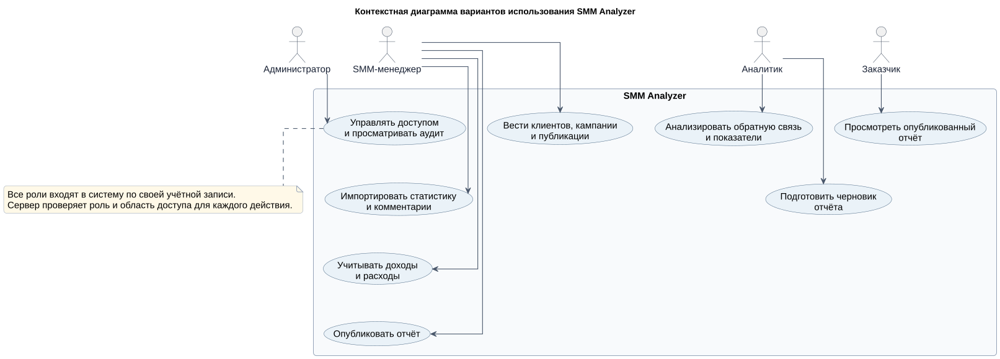

**Как читать:** сначала найти прямоугольник `SMM Analyzer`, затем акторов снаружи и связанные с ними овалы внутри.

Использованные элементы:

- **человечек** — актор, то есть роль внешнего пользователя;
- **овал** — вариант использования, полезная цель пользователя;
- **прямоугольник SMM Analyzer** — граница проектируемой системы;
- **сплошная линия** между актором и овалом — роль участвует в этом сценарии;
- **стрелка обобщения между акторами**, если она присутствует, — специализированная роль наследует возможности общей роли;
- **примечание с загнутым углом** — пояснение, которое не является отдельной функцией.

На схеме владелец агентства управляет доступом, SMM-менеджер ведёт кампании и импортирует данные, аналитик запускает анализ, заказчик просматривает опубликованные отчёты. Акторы находятся вне прямоугольника, потому что они не являются частью программной системы.

### 18.2. Декомпозиция варианта использования

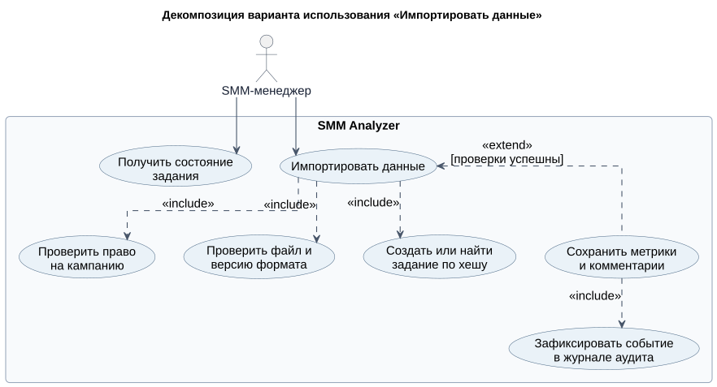

Главный овал — «Импортировать данные». Остальные овалы раскрывают внутренние части сценария.

- Пунктирная стрелка `<<include>>` направлена **от основного сценария к обязательному включаемому сценарию**. Например, импорт обязательно включает проверку права и создание задания.
- Пунктирная стрелка `<<extend>>` направлена **от дополнительного поведения к базовому сценарию**. Расширение выполняется только при условии.
- Текст возле связи объясняет условие или смысл включения.

На защите можно сказать: контекстная диаграмма показывает охват системы, а декомпозиция раскрывает один сложный пользовательский сценарий.

### 18.3. Диаграмма состояний задания импорта

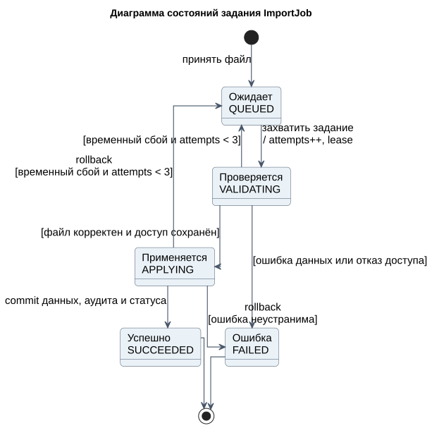

**Как читать:** двигаться от верхней чёрной точки по стрелкам к одному из конечных состояний.

Использованные элементы:

- **чёрная точка** — создание объекта и начало его жизненного цикла;
- **закруглённый прямоугольник** — устойчивое состояние объекта;
- **стрелка** — допустимый переход;
- **текст над стрелкой** — событие, вызывающее переход;
- **условие в квадратных скобках** — переход возможен только при выполнении условия;
- **мишень** — жизненный цикл завершён.

`QUEUED` означает, что задание ожидает обработки. `VALIDATING` — файл проверяется. `APPLYING` — данные применяются. `SUCCEEDED` и `FAILED` — два конечных результата. Повторная попытка показана возвратом из ошибочной ситуации к обработке только при временном сбое и допустимом числе попыток.

Здесь моделируется именно `ImportJob`. На этой схеме нельзя одновременно показывать состояния кампании или отчёта: у каждого объекта свой автомат.

### 18.4. Классы анализа: Boundary, Control и Entity

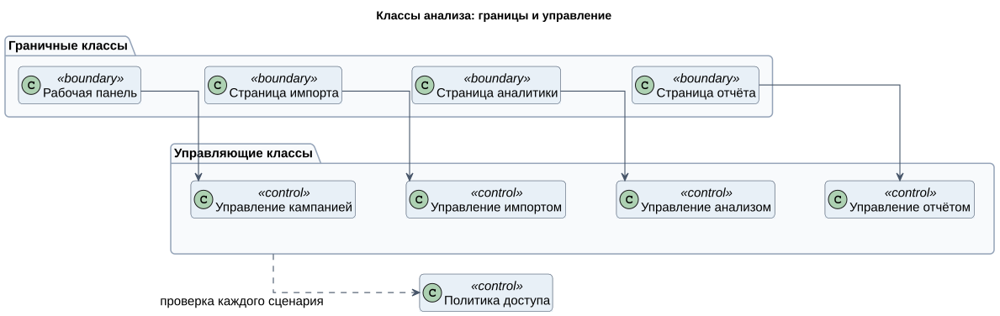

Стереотип в угловых кавычках поясняет роль класса:

- `<<boundary>>` — страница или иная граница взаимодействия;
- `<<control>>` — объект, который организует выполнение сценария;
- `<<entity>>` — долговременная сущность предметной области.

Стрелка от страницы импорта к управлению импортом означает, что интерфейс передаёт ему пользовательский запрос. Управляющий класс не должен рисовать страницу, а страница не должна самостоятельно выполнять бизнес-правила.

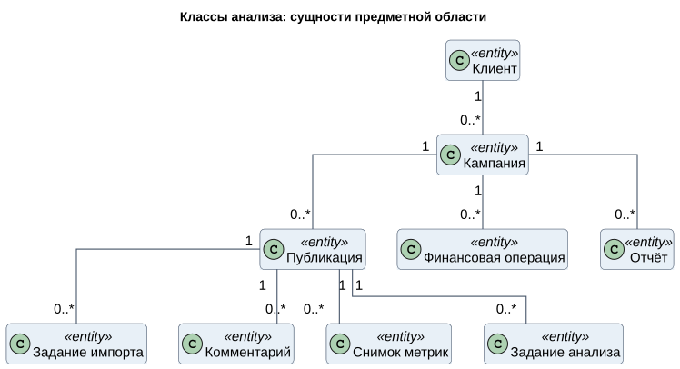

Числа возле концов связей являются **кратностями**:

- `1` — ровно один объект;
- `0..1` — ноль или один;
- `0..*` — ноль или много;
- `1..*` — один или много.

Например, один клиент связан с несколькими кампаниями, а у новой публикации может ещё не быть ни одного снимка метрик или комментария. Линия обозначает смысловую связь между сущностями, а не последовательность действий.

### 18.5. Диаграмма последовательности импорта

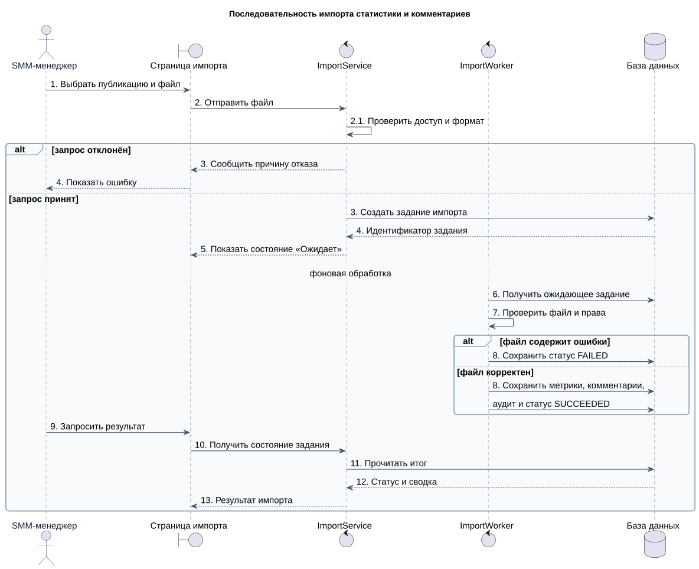

**Как читать:** участники расположены слева направо, время идёт сверху вниз.

Использованные элементы:

- **актор** — инициатор сценария;
- **прямоугольник участника** — объект или подсистема;
- **пунктирная вертикальная линия** — линия жизни;
- **сплошная стрелка** — вызов или передача сообщения;
- **пунктирная обратная стрелка** — возврат результата;
- **сообщение самому себе** — внутренняя операция объекта;
- **рамка `alt`** — взаимоисключающие варианты выполнения;
- **`else`** — альтернативная ветвь;
- **разделитель с пояснением фоновой обработки** — между этапами проходит время, Worker выполняется независимо от пользовательского запроса.

Основной успешный путь: менеджер выбирает файл, страница отправляет его сервису, сервис создаёт задание, Worker получает его и сохраняет результат. Ветка ошибки показывает, что неправильный файл не изменяет предметные данные, а задание получает `FAILED`.

Номера сообщений помогают пересказывать сценарий, но на диаграмме последовательности главным источником порядка остаётся вертикальное положение стрелок.

### 18.6. Диаграмма коммуникации

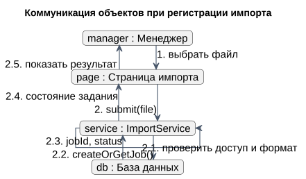

Здесь нет вертикальной временной оси. Объекты расположены так, чтобы были видны их непосредственные связи.

- `manager : Менеджер` читается как **экземпляр manager класса или роли Менеджер**;
- линия между объектами показывает возможность обмена сообщениями;
- стрелка указывает получателя сообщения;
- `2.1`, `2.2`, `2.3` задают вложенный порядок действий внутри шага 2;
- сообщение объекта самому себе обозначает внутреннюю проверку.

Цепочка читается по номерам: менеджер выбирает файл, страница вызывает сервис, сервис проверяет запрос и обращается к базе данных, затем ответ возвращается пользователю.

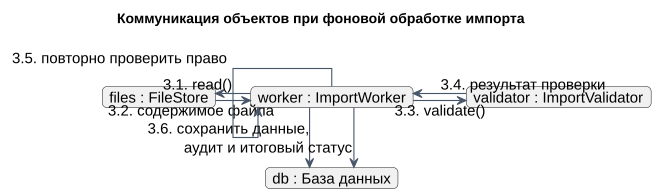

Вторая схема продолжает тот же сценарий. Worker читает файл, вызывает валидатор, повторно проверяет право и записывает результат. Разделение на два рисунка уменьшает число пересекающихся линий.

Разница с последовательностью: последовательность лучше показывает **время**, коммуникация — **структуру связей**.

### 18.7. Логическая диаграмма классов

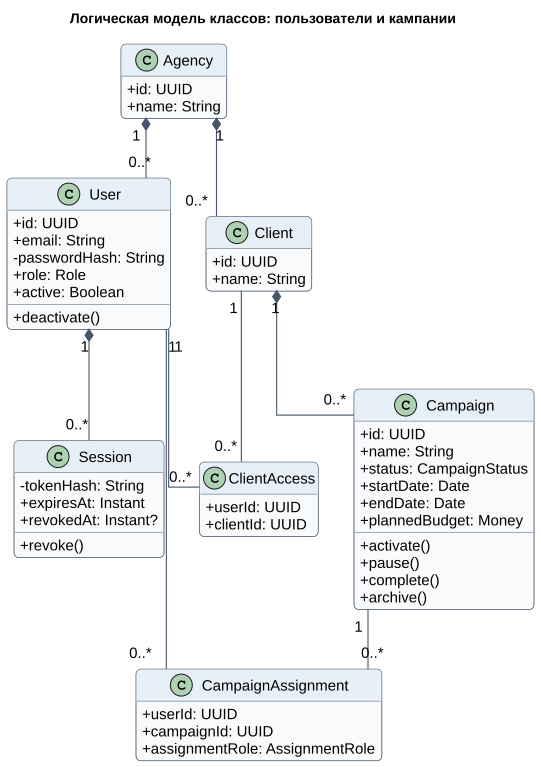

Прямоугольник класса разделён на части:

1. название класса;
2. атрибуты;
3. операции.

Обозначения членов класса:

- `+` — открытый член `public`;
- `-` — закрытый член `private`;
- `имя: Тип` — атрибут и его тип;
- `операция(параметр: Тип): Результат` — сигнатура метода;
- `UUID`, `String`, `Instant`, `Money` — типы данных;
- запись через вертикальную черту, например `ACTIVE | PAUSED`, — набор допустимых значений перечисления.

Связи:

- обычная линия — ассоциация;
- стрелка с пустым треугольником — наследование или обобщение;
- пунктирная стрелка — зависимость;
- пустой ромб — агрегация;
- закрашенный ромб — композиция, сильное владение частью.

На нашей схеме `CampaignAssignment` связывает пользователя с кампанией и хранит его роль в ней. Это отдельный класс связи, потому что сама связь имеет собственный атрибут `assignmentRole`.

### 18.8. Физическая диаграмма классов сервера

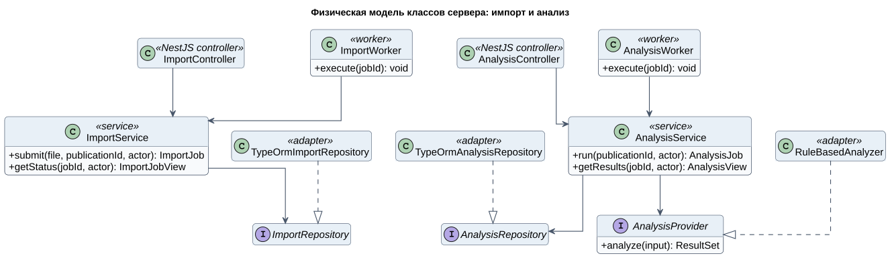

Эта схема ближе к будущему коду:

- `<<NestJS controller>>` — принимает HTTP-запрос;
- `<<service>>` — реализует прикладной сценарий;
- `<<worker>>` — выполняет фоновую задачу;
- `<<interface>>` — договор без конкретного способа реализации;
- `<<adapter>>` — техническая реализация интерфейса, например через TypeORM.

Пунктирная линия с пустым треугольником от адаптера к интерфейсу означает **реализацию интерфейса**. Сплошная стрелка от сервиса к интерфейсу означает зависимость сервиса от абстракции. Благодаря этому бизнес-логика не зависит напрямую от TypeORM.

`AnalysisProvider` нужен для заменяемости алгоритма. Сейчас его может реализовать анализатор на правилах, а позднее — ML-модель.

### 18.9. Диаграмма деятельности импорта

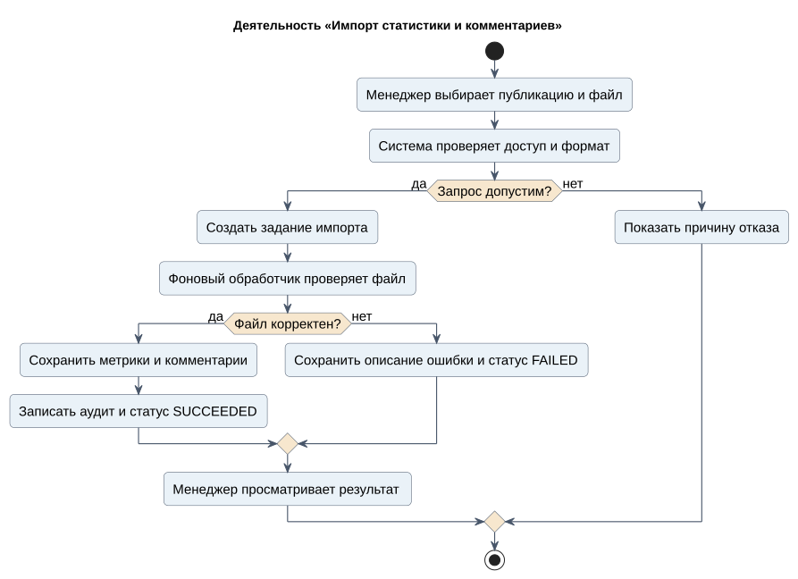

**Как читать:** сверху вниз от начальной точки до мишени.

- чёрная точка — начало процесса;
- закруглённый прямоугольник — действие;
- стрелка — переход к следующему действию;
- ромб — проверка условия;
- подписи `да` и `нет` — результаты проверки;
- мишень — завершение процесса.

В отличие от автомата состояний, здесь действия принадлежат всему процессу: менеджер выбирает файл, система проверяет его, Worker обрабатывает данные. Ромб «Файл корректен?» делит поток на успешный и ошибочный исходы.

Если используются дорожки, каждая дорожка показывает ответственного: пользователь, API или Worker. В упрощённой схеме ответственность написана прямо в названиях действий.

### 18.10. Диаграмма компонентов

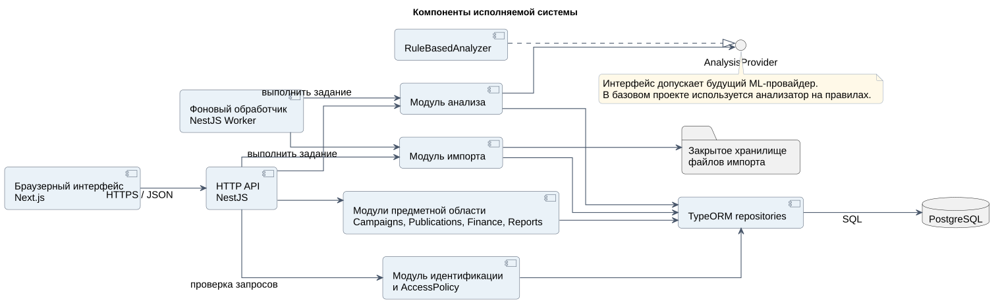

Компонент изображает крупную заменяемую часть программы. Он крупнее отдельного класса.

На схеме используются:

- **компонент** — модуль с определённой ответственностью;
- **стрелка зависимости** — один компонент использует возможности другого;
- **интерфейс AnalysisProvider** — точка подключения реализации анализа;
- **цилиндр PostgreSQL** — постоянное хранилище данных;
- **примечание** — ограничение или архитектурное решение.

Браузерный интерфейс обращается к API. API и Worker используют предметные модули. Модули работают с базой через репозитории. Worker не обслуживает внешние HTTP-запросы, а берёт фоновые задания.

Класс и компонент нельзя путать: класс является программным типом, а компонент может содержать много классов и поставляться как единая часть приложения.

### 18.11. Диаграмма развёртывания

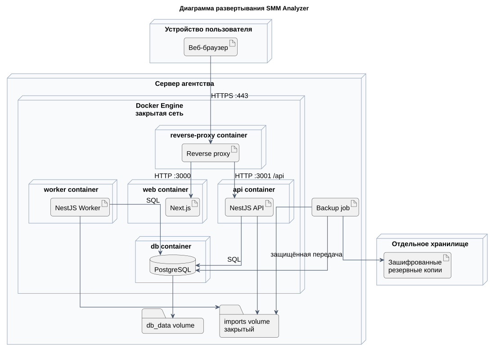

Диаграмма показывает уже не логические классы, а места выполнения программы.

- объёмный прямоугольник — физический или виртуальный узел;
- вложенный узел — среда выполнения или контейнер;
- прямоугольник внутри узла — развёрнутый программный артефакт;
- цилиндр — база данных или постоянный том;
- линия между узлами — канал связи;
- подпись `HTTPS:443`, `HTTP:3000`, `SQL` — протокол или порт;
- граница Docker network — изолированная внутренняя сеть контейнеров.

Пользователь работает через браузер. Запрос приходит на reverse proxy по HTTPS и далее передаётся веб-интерфейсу или API. API и Worker имеют доступ к PostgreSQL и внутренним томам. База данных не соединена напрямую с устройством пользователя. Резервные копии передаются в отдельное защищённое хранилище.

### 18.12. Как быстро определить тип диаграммы

| Что видно на рисунке | Тип диаграммы | Главный вопрос |
|---|---|---|
| Акторы и овалы | Варианты использования | Кто и зачем работает с системой? |
| Состояния и переходы | Автомат состояний | Как меняется один объект? |
| Boundary, Control, Entity | Классы анализа | Какие обязанности нужны сценарию? |
| Вертикальные линии жизни | Последовательность | В каком порядке идут сообщения? |
| Объекты и пронумерованные стрелки | Коммуникация | Какие объекты непосредственно связаны? |
| Классы, поля, методы и кратности | Диаграмма классов | Как устроена статическая структура? |
| Действия, ромбы и поток | Деятельность | Как проходит бизнес-процесс? |
| Крупные программные модули | Компоненты | Из каких частей собирается приложение? |
| Серверы, контейнеры и протоколы | Развёртывание | Где выполняются части системы? |

### 18.13. Универсальная формула объяснения рисунка

Для любого рисунка на защите можно использовать четыре предложения:

1. «Эта диаграмма показывает ...» — назвать назначение.
2. «Основными участниками или элементами являются ...» — перечислить 3–5 главных элементов.
3. «Основной сценарий читается так: ...» — провести по стрелкам.
4. «Альтернативная ветвь или ограничение состоит в том, что ...» — объяснить ошибку, условие доступа или кратность.

Не нужно читать каждую подпись. Важно показать, что понятны назначение диаграммы, смысл обозначений и связь с предметной областью.
